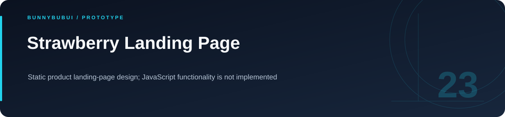

<p align="center">
  
</p>

<h1 align="center">Strawberry Landing Page</h1>

<p align="center">Static product landing-page design; JavaScript functionality is not implemented</p>

<p align="center">
    
</p>

<p align="center"><a href="#overview">ภาพรวม</a> · <a href="#features">ความสามารถ</a> · <a href="#start">เริ่มใช้งาน</a> · <a href="#structure">โครงสร้าง</a> · <a href="#validation">ตรวจสอบงาน</a></p>

<a id="overview"></a>

## ภาพรวม

หน้า landing page แนวสินค้า Strawberry เน้นองค์ประกอบภาพ ตัวอักษร เมนู และการจัด layout ด้วย HTML/CSS

<a id="features"></a>

## ความสามารถที่มีใน source

| ส่วนงาน | รายละเอียด | อ้างอิง |
|---|---|---|
| **Landing page** | จัด layout หน้าแนะนำสินค้า | [ดู source](yummy.html) |
| **Visual styling** | องค์ประกอบและรูปแบบหน้าเว็บ | [ดู source](style.css) |

<a id="start"></a>

## เริ่มต้นใช้งาน

**สิ่งที่ต้องมี:** Python 3 สำหรับเปิดเว็บเซิร์ฟเวอร์ในเครื่อง

```sh
python3 -m http.server 8000
```

เปิด [หน้าเว็บในเครื่อง](http://localhost:8000/yummy.html)

<a id="structure"></a>

## โครงสร้างที่ควรเริ่มอ่าน

| ตำแหน่ง | หน้าที่ |
|---|---|
| [pictures/](pictures) | พื้นที่งาน / ไฟล์ประกอบ |

<a id="validation"></a>

## คำสั่งและผลตรวจ

repository นี้ไม่ได้กำหนดชุด automated tests สำหรับทุก flow; ตรวจผลจาก entry point และข้อมูลสาธิตที่เกี่ยวข้อง

<a id="scope"></a>

## ขอบเขตของงาน

script.js ยังว่างอยู่ จึงนำเสนอเป็นงาน HTML/CSS และ visual layout

<a id="reading"></a>

## อ่านต่อ

- [บันทึกการเตรียม source](docs/CLEANUP.md)


---

<p align="center"><a href="https://github.com/BunnyBubui">BunnyBubui</a> · <a href="https://github.com/BunnyBubui/test">Software Portfolio</a></p>
